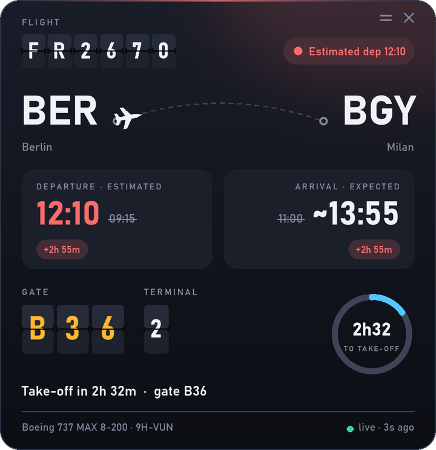
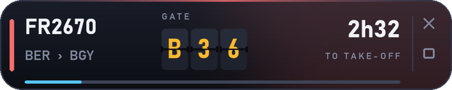
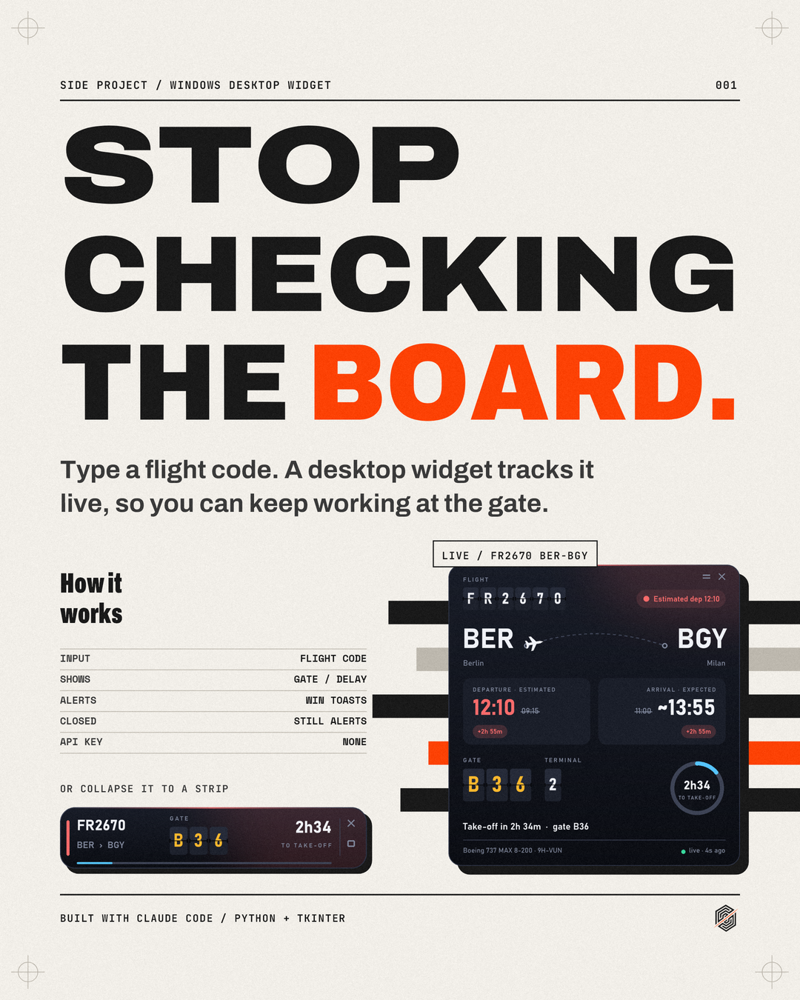

# Flight Widget

**Stop checking the board.** Type a flight code and a small always-on-top Windows widget tracks it live:
status, scheduled / estimated / actual times, delay, terminal and gate, a countdown to take-off,
in-flight progress (altitude and speed), arrival gate and baggage belt. When something changes
you get a native Windows notification, so you can keep working at the gate.

<p align="center">
  
</p>
<p align="center">
  
</p>

## Features

- **Departure board look**: flight number, gate and terminal on split-flap tiles that flip when a value changes,
  an arc route with the plane moving along it, a countdown ring, a glow in the status colour.
- **Notifications** (Windows toasts) when:
  - the gate is assigned or changes
  - departure moves by 5 minutes or more
  - take-off is 45 minutes away ("Boarding soon") and 25 minutes away ("Gate closing soon")
  - the flight takes off, lands, is cancelled or diverted, or the baggage belt is assigned
- **Collapse to a strip** with the `=` button, expand again from the strip.
- **Hide to tray** with the `×` button: the widget keeps refreshing and keeps notifying you.
  Click the plane icon in the notification area to bring it back; hover it for gate and status.
- **Smart refresh**: every 30 s in the last 90 minutes before take-off, 45 s in flight, less often otherwise.
- **English by default**, Italian available from the right-click menu.
- No API key, no account.

## Install

Windows 10/11 with Python 3.10+ (tkinter is included in the python.org installer).

```bash
git clone https://github.com/Glaas-TNQ/flight-widget.git
cd flight-widget
pip install -r requirements.txt
```

## Run

```bash
pythonw flight_widget.py FR2670
```

or double-click `run.bat` (pass the flight code as an argument, or leave it out and the widget asks for one;
it remembers the last code). For a quick look at the data in the terminal: `python fr24.py FR2670`.

| Action | How |
|---|---|
| Move | drag with the left mouse button (position is remembered) |
| Refresh now | double-click |
| Collapse / expand | `=` button, or right-click menu |
| Hide to tray | `×` button; reopen from the plane icon in the notification area |
| Change flight, opacity, always on top, language, quit | right-click menu |

Settings live in `%APPDATA%\FlightWidget\config.json`.
If notifications don't show up, check that Do Not Disturb is off.

## How it works

- `fr24.py` fetches the flight from Flightradar24's public web endpoints:
  `flight/list.json` for the flight instances (times, status, aircraft),
  the airport schedule for terminal, gate and belt, and the live feed for altitude and speed.
  It picks the instance that matters now: the one in the air, one that landed in the last 90 minutes,
  or the next one.
- `render.py` draws the card with Pillow, supersampled 2x for antialiasing, using the Bahnschrift font that ships with Windows.
- `flight_widget.py` shows it in a borderless Tk window with rounded corners (transparent colour key),
  handles dragging, buttons, the tray icon (`pystray`) and the toasts (PowerShell + WinRT, no extra dependency).

Times are shown in the local time of the relevant airport. When there is no estimated arrival but the departure
is delayed, the arrival is shown as scheduled + delay and marked with `~`.

## Disclaimer

This is a personal side project, not affiliated with Flightradar24. It relies on unofficial, undocumented endpoints
that can change or stop working at any time, and the data belongs to Flightradar24 AB: use it for personal tracking only
and check their terms before doing anything else with it. Always trust the airport screens and your airline over this widget.

## Credits

Built with [Claude Code](https://claude.com/claude-code) by Luca Tomasino.

<p align="center">
  
</p>

## License

MIT, see [LICENSE](LICENSE).
